  

  
  
  
  
  
  
  
  

---

# 📑 Awesome Document Intelligence 

> A comprehensive, SEO-optimized, and community-curated directory of **Intelligent Document Processing (IDP)** platforms, **Document AI** engines, **Optical Character Recognition (OCR)** toolkits, and **Vision-Language Model (VLM)** pipelines. Built for document AI engineers, MLOps architects, enterprise automation teams, and researchers building production RAG & data extraction workflows.

---

## 📌 Table of Contents

- [🔍 Overview & Core Concepts](#-overview--core-concepts)
- [🌐 Sector Overview & Market Dynamics](#-sector-overview--market-dynamics)
- [🏢 Enterprise SaaS & Cloud Platforms](#-enterprise-saas--cloud-platforms)
- [💻 Top Open-Source GitHub Projects](#-top-open-source-github-projects)
- [🏗️ Recommended Architecture Stacks](#-recommended-architecture-stacks)
- [🤝 How to Contribute](#-how-to-contribute)
- [💖 Support & Community](#-support--community)
- [📈 Star History](#-star-history)
- [📄 Disclaimer](#-disclaimer)

---

## 🔍 Overview & Core Concepts

**Document Intelligence** (also known as *Intelligent Document Processing* or **IDP**) sits at the intersection of Computer Vision, Natural Language Processing (NLP), and Large Multimodal Models (LMMs). It enables automated classification, spatial layout analysis, tabular data reconstruction, and semantic key-value extraction across:

- 📄 **Structured documents**: Standard tax forms, government IDs, questionnaires, ballots.
- 📑 **Semi-structured documents**: Invoices, receipts, purchase orders, utility bills, bank statements.
- 📜 **Unstructured documents**: Legal agreements, contracts, clinical trials, academic papers, emails, technical reports.

Whether deploying sovereign on-premise OCR pipelines for air-gapped compliance or integrating enterprise-grade cloud IDP APIs into ERP workflows (SAP, Oracle, Salesforce), this list curates the leading SaaS platforms and open-source foundations.

---

## 🌐 Sector Overview & Market Dynamics

> **Market Sizing & Growth Runway:**  
> The global Intelligent Document Processing (IDP) and Document Intelligence market was valued at approximately **$2.5 Billion in 2024** and is projected to surpass **$12.5 Billion by 2031**, expanding at a compound annual growth rate (**CAGR of ~28–31%**). This accelerating expansion is driven by enterprise generative AI adoption, document-to-RAG ingestion pipelines, and automation demands across banking, insurance, healthcare, and supply chain logistics.

> **Market Dynamics & Fragmentation:**  
> The sector exhibits **moderate fragmentation** rather than a winner-take-all monopoly. While hyperscale cloud providers (AWS, Google Cloud, Microsoft Azure) capture high-volume utility OCR and foundational vision APIs, enterprise customer requirements remain deeply specialized. Complex domain schemas (e.g., medical claims adjudication, freight bills of lading, mortgage underwriting), stringent data residency mandates (GDPR, HIPAA, SOC 2), and deep ERP clean-core orchestrations (SAP, Workday) allow specialized IDP vendors (ABBYY, Rossum, Hyperscience, Ocrolus) and emerging open-source Sovereign AI engines (Docling, MinerU, PaddleOCR) to maintain strong competitive moats.

---

## 🏢 Enterprise SaaS & Cloud Platforms

The following table benchmarks category-leading Document Intelligence SaaS platforms, sorted **descending by company size** (market capitalization or private venture valuation / annual revenue). Specific starting tier prices and verifiable free trial or permanent free tier quotas are documented below:

| # | Platform | Company Size (Valuation / Revenue) | Starting Tier Pricing | Free Tier / Trial Limit | Key Capabilities & Enterprise Focus |
|---|---|---|---|---|---|
| 1 | **[Google Cloud Document AI](https://cloud.google.com/document-ai)** | **~$2.1 Trillion** (Alphabet Inc. Market Cap) / **$40B+** Cloud ARR | **$1.50 per 1,000 pages** ($0.0015/page) for Enterprise Document OCR; **$10.00 per 1,000 pages** for Layout Parser; **$30.00 per 1,000 pages** for Form Parser & Custom Extractors | **1,000 pages/month free forever** for Enterprise Document OCR; **90-day free trial** with **$300 cloud credits** applicable to specialized and custom parsers | Layout Parser for complex multi-column structures, pre-trained entity extractors (Invoices, Receipts, W-2s, IDs), human-in-the-loop review console, and Vertex AI multimodal grounding. |
| 2 | **[AWS Textract](https://aws.amazon.com/textract/)** | **~$2.0 Trillion** (Amazon.com Market Cap) / **$105B+** AWS ARR | **$1.50 per 1,000 pages** ($0.0015/page) for Detect Document Text API; **$10.00 per 1,000 pages** for Analyze Expense; **$15.00 per 1,000 pages** for Tables; **$50.00 per 1,000 pages** for Forms | **90-day free trial** (first 3 months): **1,000 pages/month** for Detect Document Text and **100 pages/month** for Analyze Document (Tables, Forms, Queries, Expense, ID) | Serverless managed OCR, synchronous API up to 10 MB and async multi-page processing up to 500 MB PDFs, specialized AnalyzeExpense and AnalyzeID endpoints with bounding box coordinates. |
| 3 | **[ServiceNow Document Intelligence](https://www.servicenow.com/)** | **~$190 Billion** (ServiceNow Market Cap) / **$10.0B+** ARR | Packaged within **ServiceNow Automation Engine** starting at **~$100/user/month** (Enterprise platform annual commitments typically start from **~$40,000/year**) | **Free forever access** via ServiceNow Personal Developer Instance (PDI) for developers; **30-day proof-of-concept (PoC)** sub-production instance on sales/partner request | Now Assist in Document Intelligence (NADI) leverages LLM zero-shot extraction guided by plain-English field descriptions without template training, feeding directly into ServiceNow workflows. |
| 4 | **[Automation Anywhere IDP](https://www.automationanywhere.com/)** | **~$7.3 Billion** (Private Valuation) / **$500M+** ARR | **$750/month** ($9,000/year base) for Cloud Starter / Document Automation pack, scaling with overage packages at **~$0.15 per page** | **Free forever Community Edition**: provides up to **100 pages/month** of GenAI-powered Document Automation for small businesses and developers (up to 3 bot runners) | Agentic IDP natively integrated into Automation 360; blends traditional ML with generative LLMs to extract, cross-validate against ERP databases, and dispatch software bots for touchless resolution. |
| 5 | **[Kofax TotalAgility](https://www.tungstenautomation.com/)** | **~$2.0 Billion+** (Tungsten Automation Valuation) / **$500M+** Revenue | Baseline modular platform configurations start from **$83/user/month** or **~$10,000/year** entry platform license | **30-day guided evaluation / PoC** with full enterprise features and up to **500 document transformations** upon sales or authorized partner registration | Hybrid cloud/on-premise capture platform combining low-code workflow orchestration, cognitive OCR, Azure OpenAI connector for content classification, and deep ERP/ECM connectors. |
| 6 | **[Hyperscience](https://hyperscience.com/)** | **~$1.6 Billion** (Series E Unicorn Valuation) / **$70M+** ARR | Enterprise annual platform subscriptions start from **~$40,000/year** (effective volume-based unit pricing scales between **$0.20 to $0.50 per page**) | **30-day proof-of-concept (PoC)** evaluation sandbox with **250 to 1,000 sample documents** provisioned via enterprise sales or AWS Marketplace Private Offer | Hypercell architecture designed for mission-critical banking and government documents; industry-leading handwriting recognition (ICR), automated quality assessment, and human-in-the-loop audit trails. |
| 7 | **[ABBYY Vantage](https://www.abbyy.com/)** | **~$1.5 Billion+** (Marlin Equity Valuation) / **$300M+** Revenue | Vantage Core & Skills subscriptions start at **~$999/month** ($10,000/year base tier) or **$0.05 to $0.15 per transaction** across metered volume blocks | **60-day free trial** including **2,000 pages** for core cognitive skills and **1,000 pages** for each pre-trained skill (invoices, receipts, purchase orders, mortgages) | No-code cognitive skill design, marketplace of 150+ pre-trained document models, citation-backed LLM prompt extraction, and SOC 2 / HIPAA compliance for sovereign architectures. |
| 8 | **[Rossum](https://rossum.ai/)** | **~$1.25 Billion** (Series A Unicorn Valuation) / **$30M+** ARR | Starter tier starts at **$18,000/year** (~$1,500/month billed annually) including core AI extraction (Aurora LLM engine) and unlimited user seats | **14-day free trial** with **300 document processing credits**, complete with live validation queues and self-learning feedback loops | Proprietary Aurora vision-language model trained specifically on transactional documents; SAP Clean Core certified, multi-page order processing across 276 languages with 98% claimed accuracy. |
| 9 | **[Ocrolus](https://www.ocrolus.com/)** | **~$500 Million+** (Series C Valuation) / **$45M+** ARR | API volume pricing starts at **$0.10 to $0.25 per page** with minimum monthly commitment contracts starting at **$1,000/month** ($12,000/year) | **30-day developer sandbox** free trial analyzing up to **100 pages** of financial documents (bank statements, W-2s, 1040 tax forms, pay stubs) | Tailored for financial lending, mortgage underwriting, and fintech intake; features Detect forensics to identify digital document tampering and synthetic PDF file manipulation. |
| 10 | **[Infrrd](https://www.infrrd.ai/)** | **~$175 Million+** (Growth Round Valuation) / **$25M+** ARR | Enterprise outcome-based contracts start at **~$2,000/month** ($24,000/year); developer self-service IDP Forge starts at **$0.05 per page** | **Developer Free Tier** on IDP Forge granting complimentary initial ForgeCoins testing credits; **14-day / 500-document** enterprise PoC evaluation on request | Doc Studio zero-shot no-code model builder from single reference documents; Smart Doc Q&A for interactive unstructured document interrogation and complex diagram extraction. |

---

## 💻 Top Open-Source GitHub Projects

The following repositories represent the premier open-source foundations for self-hosted document processing, local OCR, table recognition, layout decomposition, and RAG chunking.

Each entry includes a live social star badge linking directly to the repository's stargazers page, **sorted strictly descending by GitHub star count**:

1. **[PaddleOCR](https://github.com/PaddlePaddle/PaddleOCR)**   
   *Ultra-lightweight and industrial-grade OCR toolkit based on PaddlePaddle; supports 80+ languages, table structure analysis (PP-Structurev2), key information extraction, and on-device mobile/edge deployment.*

2. **[MinerU](https://github.com/opendatalab/MinerU)**   
   *High-precision document extraction engine for converting complex scientific PDFs, equations, academic papers, and multi-column books into clean LLM-ready Markdown and structured JSON.*

3. **[Tesseract OCR](https://github.com/tesseract-ocr/tesseract)**   
   *The definitive, battle-tested open-source OCR engine originally developed by HP and maintained by Google; supports line-finding, character classification, and LSTM-based neural text recognition for 100+ languages.*

4. **[Docling](https://github.com/docling-project/docling)**   
   *IBM Research toolkit for parsing complex PDF, DOCX, PPTX, and scanned documents; incorporates DocLayNet layout segmentation, TableFormer table structure extraction, and seamless LangChain/LlamaIndex RAG exporters.*

5. **[Paperless-ngx](https://github.com/paperless-ngx/paperless-ngx)**   
   *Full-featured, community-supported document management system; transforms physical documents into searchable digital archives with automated Tesseract OCR, metadata tagging, full-text indexing, and REST APIs.*

6. **[Marker](https://github.com/datalab-to/marker)**   
   *Blazing-fast deep learning pipeline that converts PDF documents to pristine Markdown and JSON; recognizes code blocks, LaTeX mathematical formulas, tables, and multi-column article layouts.*

7. **[OCRmyPDF](https://github.com/ocrmypdf/OCRmyPDF)**   
   *Production utility that injects searchable OCR text layers into scanned PDF files while preserving original raster imagery; features deskewing, automatic image optimization, and PDF/A compliance.*

8. **[EasyOCR](https://github.com/JaidedAI/EasyOCR)**   
   *Ready-to-use Python library for optical character recognition powered by PyTorch; supports 80+ languages and scripts (including Latin, Arabic, Devanagari, Chinese, Cyrillic) with simple out-of-the-box APIs.*

9. **[UniLM / LayoutLM](https://github.com/microsoft/unilm)**   
   *Microsoft Research foundational models for Document AI; introduces multimodal pre-training across 2D spatial layouts, textual tokens, and visual images (LayoutLM, LayoutLMv2, LayoutLMv3, and LayoutXLM).*

10. **[olmOCR](https://github.com/allenai/olmocr)**   
    *Allen Institute for AI toolkit for converting heterogeneous PDF documents into clean, linearized natural language text tailored specifically for large language model pre-training and RAG datasets.*

11. **[Unstructured](https://github.com/Unstructured-IO/unstructured)**   
    *Open-source modular ETL library for document preprocessing; partitions raw PDF, Word, HTML, and image documents into semantic chunks with downstream connectors for vector databases.*

12. **[pdfminer.six](https://github.com/pdfminer/pdfminer.six)**   
    *Community-maintained Python PDF extraction package; inspects exact font metrics, layout coordinates, glyph positions, and embedded image metadata directly from native PDF binary streams.*

13. **[pytesseract](https://github.com/madmaze/pytesseract)**   
    *Lightweight Python wrapper for Google's Tesseract-OCR engine; supports PIL images, bounding box coordinate retrieval, confidence scores, and hOCR output formats.*

14. **[docTR](https://github.com/mindee/doctr)**   
    *Seamless end-to-end document text recognition powered by TensorFlow 2 and PyTorch; provides modular two-stage detection (DBNet) and recognition (CRNN, SAR, Master) architectures.*

15. **[Layout-Parser](https://github.com/Layout-Parser/layout-parser)**   
    *Unified deep learning toolkit for document image analysis; offers pre-trained models for document layout decomposition, reading order detection, and integration with downstream OCR backends.*

16. **[Apache Tika](https://github.com/apache/tika)**   
    *The industry-standard content analysis toolkit; auto-detects MIME types and extracts structured metadata and textual content from over 1,600 file formats with Java and Python bindings.*

17. **[Docext](https://github.com/Nanonets/docext)**   
    *Nanonets on-premises, OCR-free unstructured data extraction and markdown conversion framework; includes benchmarking utilities for evaluating multimodal LLMs against document workloads.*

18. **[TWIX](https://github.com/ucbepic/TWIX)**   
    *UC Berkeley open-source data extraction engine that reconstructs structured tabular data at scale by inferring shared visual templates across high-volume document batches.*

19. **[DocSlight](https://github.com/ComPDFKit/docslight)**   
    *ComPDFKit AI document parsing project; supports bounding box traceability, layout understanding, and field extraction for PDF, scans, and Office files outputting Markdown/JSON.*

20. **[pyonb](https://github.com/SAFEHR-data/pyonb)**   
    *Multi-engine OCR routing and forwarding SDK bundling Marker, PaddleOCR, and Sparrow behind a unified microservice API for clinical records and archival processing.*

---

## 🏗️ Recommended Architecture Stacks

Depending on privacy constraints, budget, and document throughput, standard production architectures fall into three tiers:

```mermaid
flowchart TD
    subgraph Sovereign["1. Sovereign On-Premise Stack (Zero API Cost)"]
        A1[Raw Scans & PDFs] --> B1[Docling / MinerU Layout Parser]
        B1 --> C1[PaddleOCR / Tesseract Engine]
        C1 --> D1[Local LLM / Ollama vLLM Extraction]
        D1 --> E1[PostgreSQL / Vector DB]
    end

    subgraph Hybrid["2. Hybrid Cloud RAG Stack"]
        A2[Mixed Documents] --> B2[Unstructured Partitioning]
        B2 --> C2[Marker / OCRmyPDF Conversion]
        C2 --> D2[LlamaIndex / LangChain Chunking]
        D2 --> E2[Enterprise Knowledge Base]
    end

    subgraph Enterprise["3. Turnkey Enterprise IDP Stack"]
        A3[Financial / Legal Intake] --> B3[Rossum / ABBYY / Google Doc AI]
        B3 --> C3[Human-in-the-Loop Validation UI]
        C3 --> D3[SAP / Oracle ERP Clean Core]
    end
```

---

## 🤝 How to Contribute

Contributions from document AI practitioners, researchers, and developers are warmly welcomed!

1. 🍴 **Fork the repository** on GitHub.
2. 🌿 **Create a feature branch**: `git checkout -b feature/add-new-idp-tool`.
3. 📝 **Edit `README.md`**: Follow existing formatting rules (include specific pricing, free limits, company sizes, and valid badge links).
4. ✅ **Ensure accuracy**: Verify links, maintain alphabetical or star-sorted ordering where applicable.
5. 🚀 **Submit a Pull Request** with a concise description of your additions.

---

## 💖 Support & Community

Thank you for exploring this curated directory of Document Intelligence tools and technologies! If you find this resource valuable for your research, projects, or enterprise workflows:

- ⭐ **Star this repository** on GitHub to help others discover it.
- 🍴 **Fork the repo** to contribute new tools, benchmarks, or updates.
- 📢 **Share it** with fellow document AI engineers, data scientists, and automation architects.
- ☕ **Support the maintainer**: If you'd like to support ongoing curation and maintenance, consider buying a coffee via the [GitHub Sponsor Dashboard](https://github.com/sponsors/ishandutta2007).

Your support keeps this ecosystem up-to-date, accurate, and community-driven!

---

## 📈 Star History

---

## 📄 Disclaimer

- This repository is an independently curated community resource for informational purposes and does not constitute an endorsement.
- All product names, logos, and brands are property of their respective owners.
- Compliance with data privacy frameworks (**GDPR, HIPAA, FERPA, CCPA, SOC 2 Type II**) is critical when processing personal, clinical, or confidential business documents. Implement human-in-the-loop review for high-liability financial and regulatory workflows.
- Always review individual software licenses (Apache-2.0, MIT, AGPL, commercial proprietary) before embedding into commercial applications.

---

  <b>Made with ❤️ for Document AI Engineers, Automation Architects, and Intelligent Document Processing Practitioners.</b> 
  Let's build more open, accurate, and automation-ready document intelligence pipelines.

